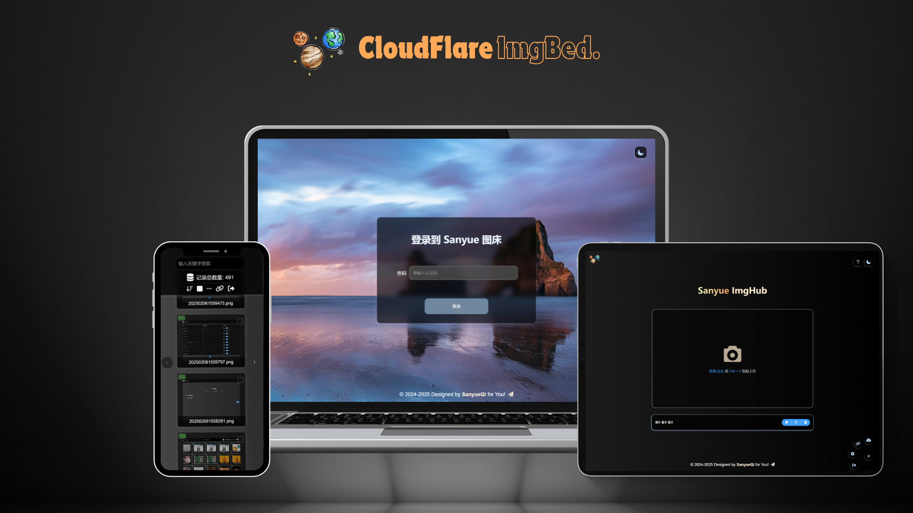

# CloudFlare ImgBed

[English](README_en.md) | [在线文档](https://cfbed.sanyue.de) | [演示站点](https://cfbed.1314883.xyz/)

基于 Cloudflare Workers 的开源文件托管服务，支持 Telegram、Discord、Cloudflare R2、S3、Hugging Face 和 WebDAV，提供上传、管理、目录浏览、鉴权、临时链接、随机图、音乐、视频与聊天页面。



## 开发与部署

```bash
npm ci
npm start
```

常用命令：

| 命令 | 用途 |
| --- | --- |
| `npm test` | 运行测试与 Worker 路由一致性检查 |
| `npm run typecheck` | 检查共享安全、MIME、分片协议与上传策略的类型契约 |
| `npm run build:worker` | 执行 Workers 部署预检 |
| `npm run worker:dev` | 启动本地开发服务，默认端口 `8788` |
| `npm run worker:deploy` | 部署生产环境 |
| `npm run worker:deploy:dev` | 部署 `dev` 环境 |
| `npm run worker:secret -- <NAME>` | 写入 Worker 密钥 |

Worker 入口、静态资源和绑定配置位于 [`wrangler.toml`](wrangler.toml)。首次部署前请确认 KV、R2、D1 与 Durable Object 配置符合实际使用场景。

完整部署说明、功能文档、更新日志与常见问题请查看[在线文档](https://cfbed.sanyue.de)。

## 项目结构

```text
functions/   Pages Functions 风格的业务处理器
src/         Worker 入口、路由适配与 Durable Object
js/ css/     前端构建产物与增强脚本
scripts/     部署资源准备与前端补丁脚本
database/    D1 初始化与迁移脚本
test/        自动化测试
```

前端源码位于 [MarSeventh/Sanyue-ImgHub](https://github.com/MarSeventh/Sanyue-ImgHub)。

## 文档预览与安全升级

当前技术栈为原生 JavaScript Workers、Pages Functions 兼容路由、Vue 3 / Element Plus 编译前端、KV / 可选 D1、R2 等多存储通道，以及上传协调 Durable Objects；不是 Hono 或完整 TypeScript 项目。

- PDF 使用原生 iframe，后端支持流式 Range、HEAD、ETag / If-Range / 304 / 412 / 416；文件读取不经过上传 DO。
- DOCX 与 Excel 在浏览器本地按需解析，私密文件不自动外发。PPT / 旧 DOC 仅在明确授权且可匿名访问后使用微软查看器；私密旧格式需下载或另部署可信转换服务。
- 已修复 Referer 伪授权、临时链接长期缓存、XML / XSLT 同源脚本、SSRF 地址绕过，以及分片大小与会话绑定缺陷。
- 删除逻辑已合并：远端失败保留元数据，Discord 分片支持幂等重试，WebDAV / 目录删除不会误报完成。上传清理只使用服务端会话分片数，并防止清理与 DO 合并竞态。
- HF 大文件直传先完成分片再提交引用，完成目标绑定服务端签发会话；异常保留恢复收据，不盲重发。提交只携带分片结果，不再回传或打印大量签名 URL。
- 应用层不限制上传文件大小、扩展名或 MIME 类型，旧 `UPLOAD_MAX_*` / `UPLOAD_ALLOWED_*` 配置不再生效。Cloudflare 与存储通道自身的限制仍适用；分片的 `fileSize` / `chunkSize` 用于完整性校验，不是文件大小配额。部署后强制刷新旧浏览器缓存。
- 配置示例见 `.dev.vars.example`。生产必须设置强管理员凭据；`FETCH_ALLOWED_HOSTS` 为空时 URL 抓取代理关闭。精确 CORS 白名单不代替鉴权。

完整审计、修复原理、配置迁移、Git 历史检查、验证结果与后续优化方案见 [审计报告](docs/audit-upgrade-2026-10.md)。默认 Office 本地预览限制为 15 MiB，Excel 展示最多 300 行 / 50 列；复杂排版与图表可能降级。

上述解析保护不限制文件上传。远程 URL 导入代理仍保留 25 MiB / 10 秒保护；External 重定向渠道的文档目前需使用新窗口打开，不能直接在应用内 fetch 预览。DOCX 最终 DOM 渲染的超时提示也不是可抢占 CPU 的硬限。

当前 506 项测试、增量类型检查和 Worker 部署预检通过。HF 提交 / 完成分片的控制 JSON 预算为 2 MiB，初始化为 64 KiB；这些预算不是上传文件配额。未部署生产，也未改写 Git 历史。

冗余清理尚未执行，以下删除项等待确认；编译哈希文件和部署补丁脚本都有真实运行引用，不能直接删除。

| 文件路径 | 处理建议 |
| --- | --- |
| `functions/dav/_middleware.js` | 确认仅支持 Workers 后删除旧 Pages 包装 |
| `functions/file/_middleware.js` | 同上，Worker 已有独立方法 / CORS 链 |
| `functions/random/_middleware.js` | 同上 |
| `functions/temp/_middleware.js` | 同上，保留临时链接业务处理器 |
| `functions/upload/_middleware.js` | 同上，Worker / DO 已处理预检 |
| `functions/music/_middleware.js` | 同上，原包装为 no-op |
| `functions/utils/deleteFile.js` 与 `functions/api/manage/delete/[[path]].js` | 已合并共享实现并补远端失败回归测试；保留工具与路由兼容入口，不删除文件 |
| `functions/file/fileTools.js`、`functions/upload/chunkProtocol.js`、`functions/upload/chunkUpload.js`、`functions/utils/auth/tokenValidator.js` | 保留文件；其中 6 个无调用导出函数列入待确认清理，函数名和证据见审计报告 |
| `package.json` 的 `overrides.fast-xml-parser` | 新 SDK 已不使用该包，待确认移除失效配置；四个直接依赖均保留 |
| `js/*.hash.js`、`css/*.hash.css`、`scripts/patch-*.mjs`、`test/`、数据库 SQL | 保留，含动态加载 / 构建 / 回归 / D1 实际引用 |
| `img/海报.png` | 保留 README 引用，仅排除静态部署，已执行 |
| `.github/workflows/sync-release.yml` | 无上游发布同步需求时可确认删除 |
| `.github/workflows/sync.yml` | 确认后禁用或改为人工 PR 同步，避免定时同步与定制代码冲突 |

当前没有误跟踪的构建 / 常见密钥文件，因此无需 `git rm --cached`。未删除项目文件、改写 Git 历史或部署线上；上线应清理旧边缘缓存，受限文件避免绕过 Worker 的 Cache Everything 规则。

## License

[MIT](LICENSE)

## 维护与验证

要求 Node.js 22.12.0 或更高版本。`npm test` 不需要启动本地服务或预先构建静态资源；
`npm run ci-test` 为其兼容别名。CI 同时在 Linux 和 Windows 上运行检查。

`node scripts/copy-assets.mjs` 会重新生成 `.wrangler-assets/`，不复制隐藏文件、
本地密钥、source map、预压缩文件和文档截图，并清除已失效的嵌套构建产物。
请勿在该生成目录中存放手工维护的文件。构建不会复制符号链接，遇到带链接的目标目录会报错。
更新上游前端构建产物时仍需保留并执行现有前端补丁脚本。
